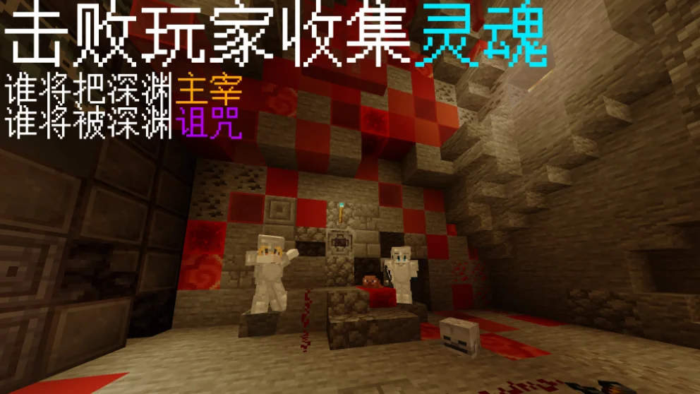
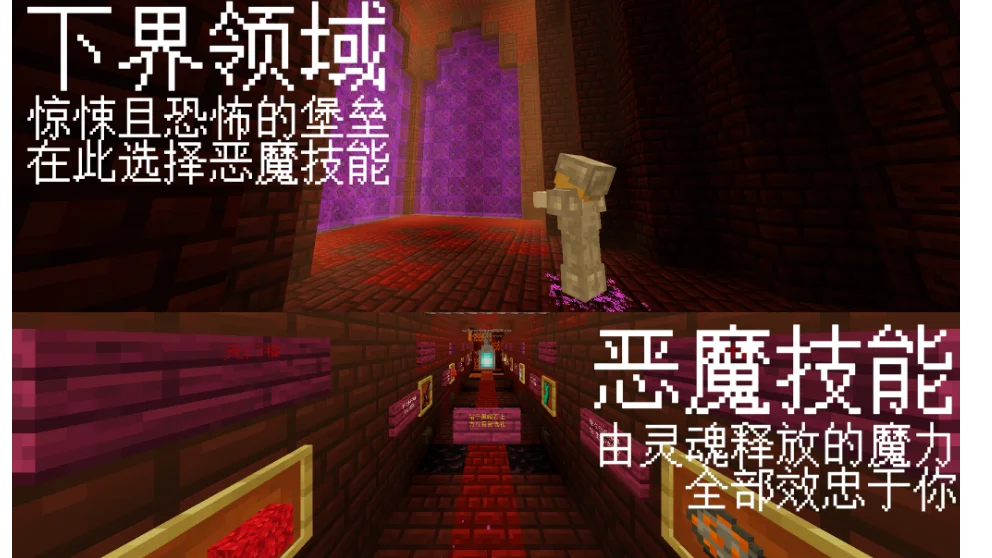
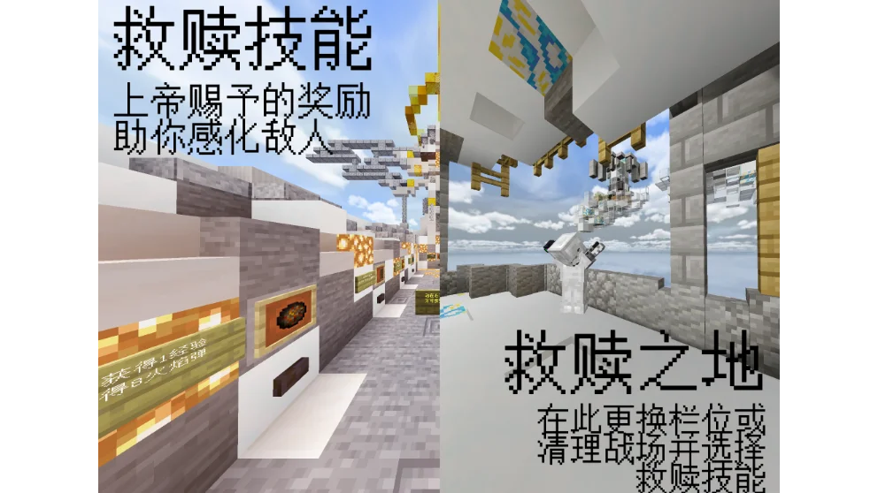

# ABYSS天坑

## 作品展示

地图:ABYSS天坑

作者:鸣凤吖,SuperCuter,BAI_ONLY

主要测试人员:Dormivg

**本地图仅支持多人游玩!**

**本地图由CINE_GAME(KCINE)代发.**

## 地图简介

本地图为乱斗PVP地图为主,每个玩家各自为战,也有纯净1v1对战.

内含大量拓展玩法.

## 武器简介

地图中的弓和雪球都经过了强化,箭在一段时间后发生爆炸,雪球可以使方块变的易碎.

## 技能简介

恶魔之牙技能:选择恶魔之牙技能后,玩家每次获得击杀时,会触发对应的特殊药水效果.

救赎之翼技能:选择救赎之翼技能后,玩家每次到达游戏内指定目标后,会给予特定的增益物品.

## 方块皮肤系统

当到达一定击杀数后,会自动更换方块的颜色,在你的击杀下让你变得特立独行!

## 连杀系统

在多次击杀并没有死亡时,系统会实时播报连杀提示。快和小伙伴一起去carry全场吧!

## 注

若发现地图BUG请在评论区告知我们,你的支持对我们真的很重要!

预览图使用光影为视差光影.
