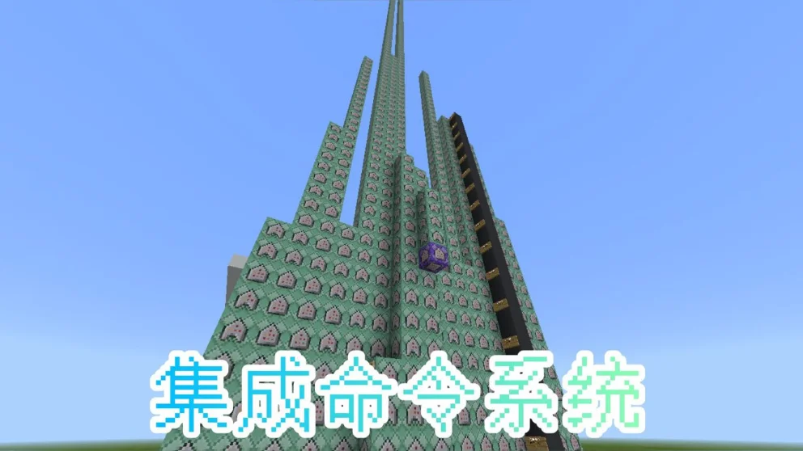
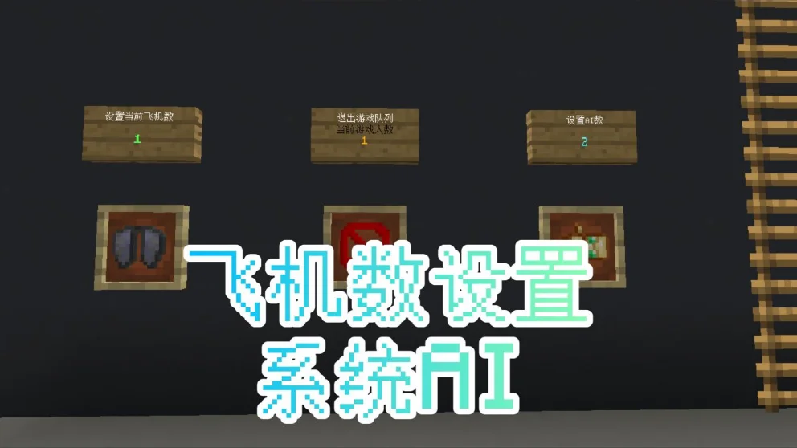
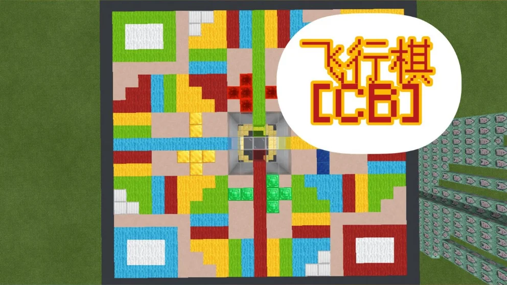

## 作品展示

## 商店说明

**飞行棋[CB]**

**作者：KCINE**

基本还原了经典飞行棋玩法

并且制作了AI机器人可以加入对战

当然可以全部设置成机器人

建议用生存模式进行游玩

以下规则不同：

5,6点数起飞且掷6不可再次投掷

"大跳跃"不会击落路径上的敌机

其他规则参考经典飞行棋

如有bug请反馈群1060796710电影游戏社

电影游戏社欢迎各路制作好玩游戏的大神加入

我们只是一个社团性质的由各路MC游戏制作爱好者组成的团体，并非工作室

---

以上为原商店说明，旧联系方式及招募文字仅作历史记录。当前联系入口见[关于我们](#/studio)。

[查看网易资源中心原页面](https://resource-minecraft.h5.163.com/#/detail?uid=2772171834&id=4648967044809257014) · 收录日期：2026-10-10
