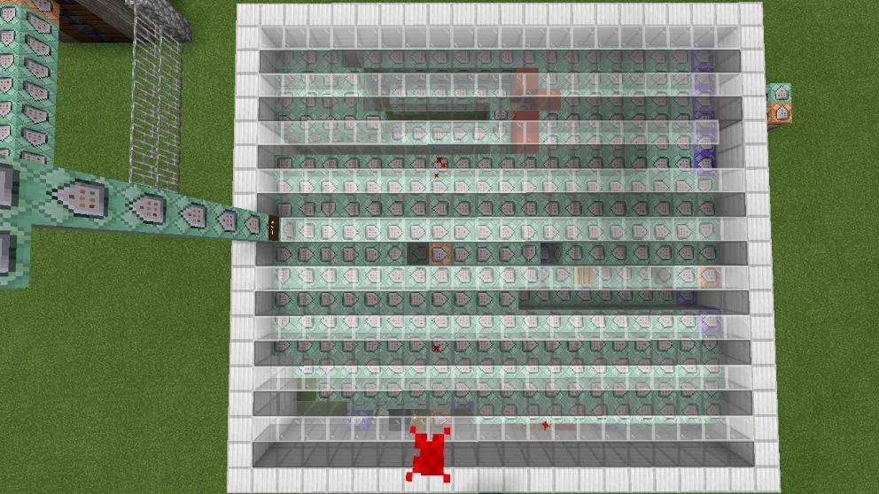
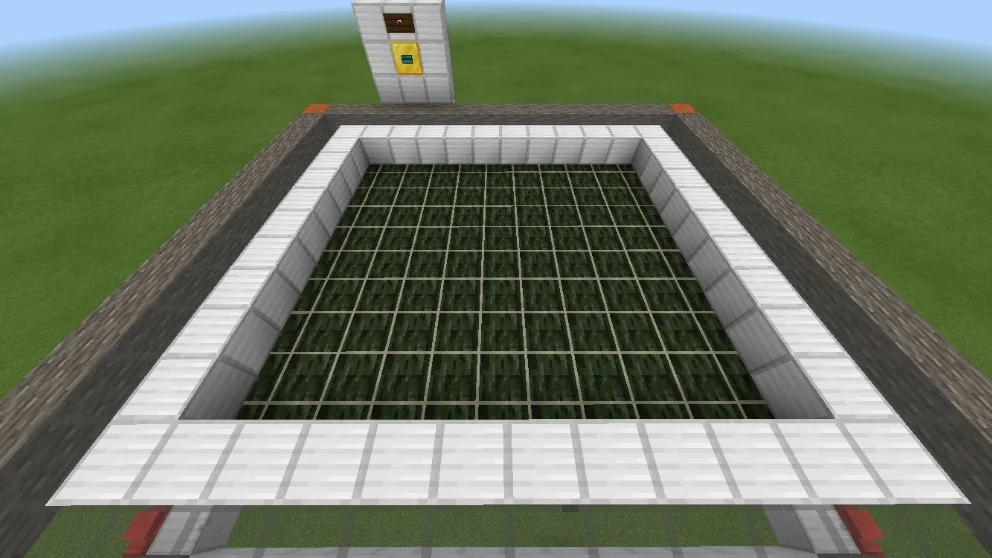
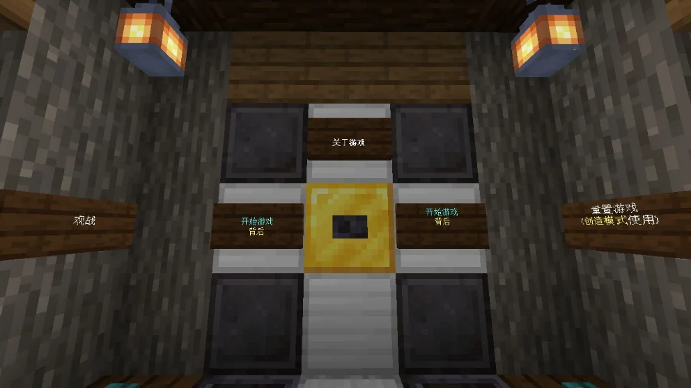

## 作品展示

## 商店说明

> **兼容性提醒：**原商店说明表示游戏更新后所需实体被删除，地图无法游玩。本站尚未核实其恢复情况，请先查看网易平台的最新说明。

**中国象棋**

**作者:KCINE**

**游玩须知**:(1)双人对弈,支持多人观战,设有观战区

(2)对弈者用蝙蝠生成蛋选择棋子(可多次选择)

使用兔子生成蛋落子(需要放置玻璃上)

(3)本地图纯命令制作,如果有bug请及时联系作者,群号:1060791710

(4)内有重置游戏按钮,遇到问题请按它

======================

***更新小贴士:游戏更新，mod实体被删除，导致地图已经无法游玩，望见谅，作者大大正在全力更新***

如果喜欢我们的作品，别忘了给一个好评哦

Fimel Studio交流群807646558/1060796710

Fimel Studio也在火热招贤纳士啦，我们热烈欢迎有经验有技术的指令人员，建筑人员，addons制作者，视频剪辑以及宣传人才加入我们，加群就可以审核啦

---

以上为原商店说明，旧联系方式及招募文字仅作历史记录。当前联系入口见[关于我们](#/studio)。

[查看网易资源中心原页面](https://resource-minecraft.h5.163.com/#/detail?uid=2772171834&id=4647154283526030957) · 收录日期：2026-10-10
