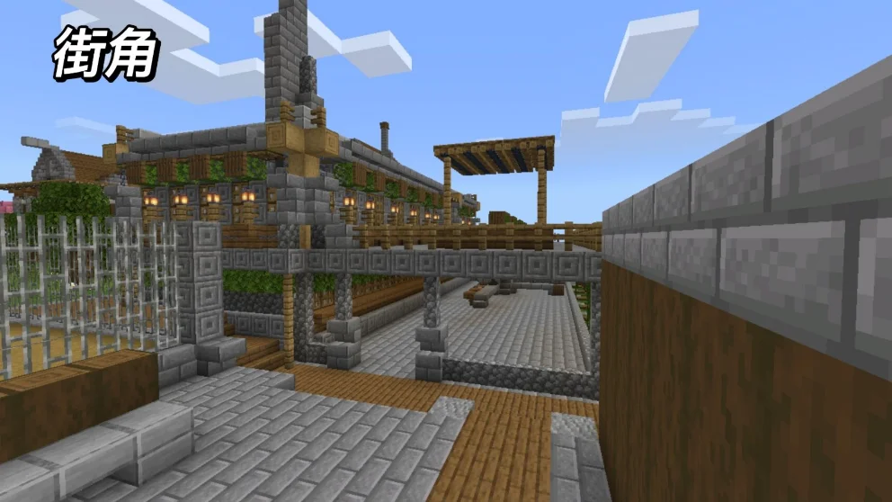
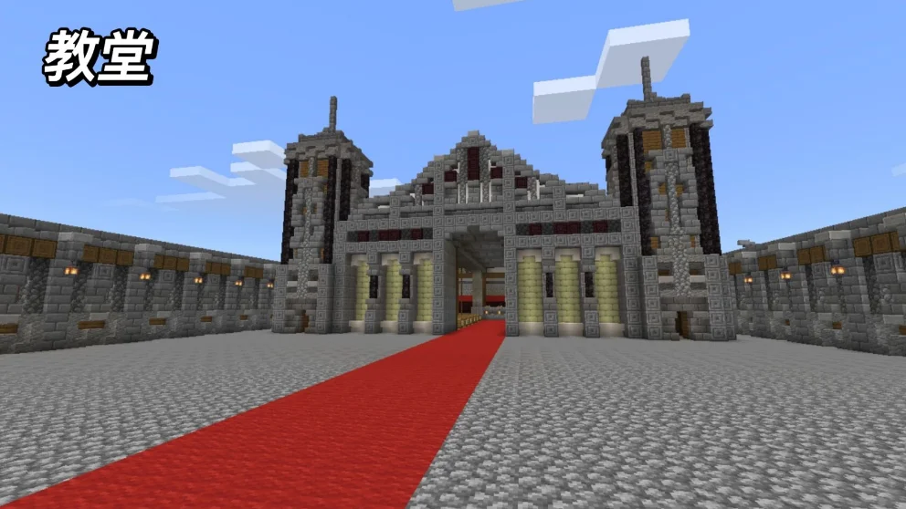
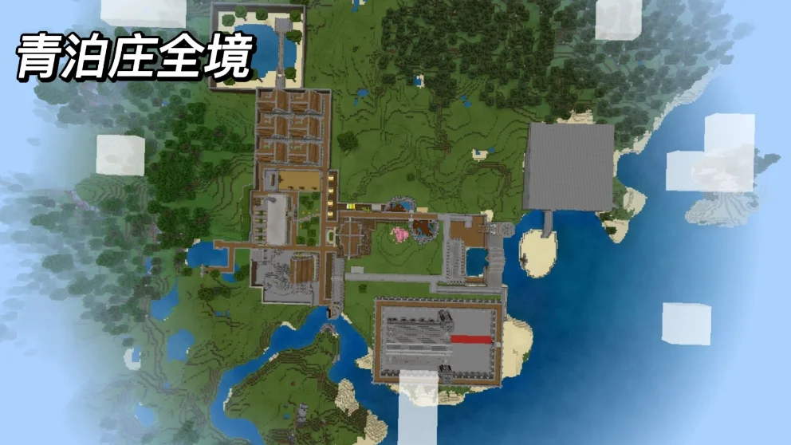

## 作品展示

## 商店说明

［Ej］系列为建造老e单独建造系列，风格简约，适合生存使用，支持多人联机。

地图介绍：青泊庄全境约5000x6000平方米，其中分为了港口(出生地)，造船厂，种植区，家园区，海滨浴场，主广场，矿山及煤矿厂，旅馆，酒庄等。

关于地图：简单，保留物品栏，昼夜更替，生存模式。

地图用心制作，烦请5星支持。

作者：建造老e。

体验及帮助：水晶215。

如果喜欢我们的作品，别忘了给一个好评哦

Fimel Studio交流群937760015/1060796710

Fimel Studio也在火热招贤纳士啦，我们热烈欢迎有经验有技术的指令人员，建筑人员，addons制作者，视频剪辑以及宣传人才加入我们，加群就可以审核啦

---

以上为原商店说明，旧联系方式及招募文字仅作历史记录。当前联系入口见[关于我们](#/studio)。

[查看网易资源中心原页面](https://resource-minecraft.h5.163.com/#/detail?uid=2772171834&id=4649651119622229329) · 收录日期：2026-10-10
