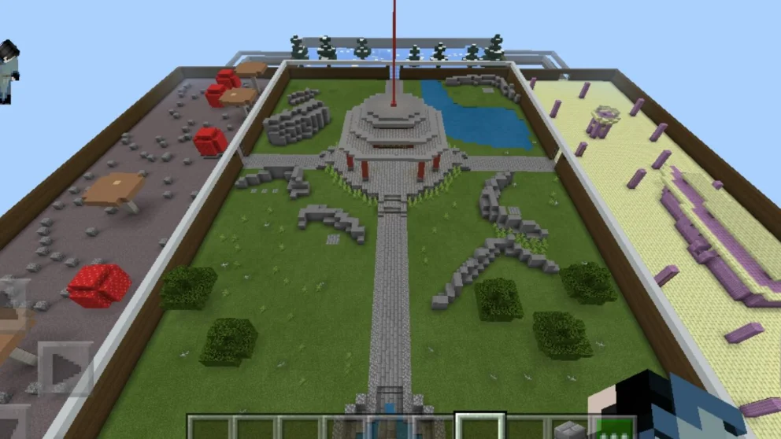
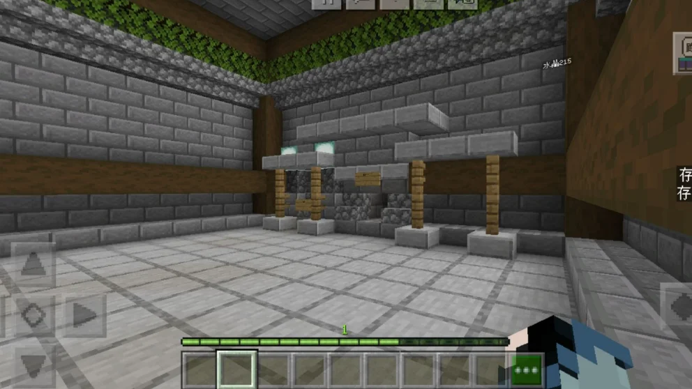
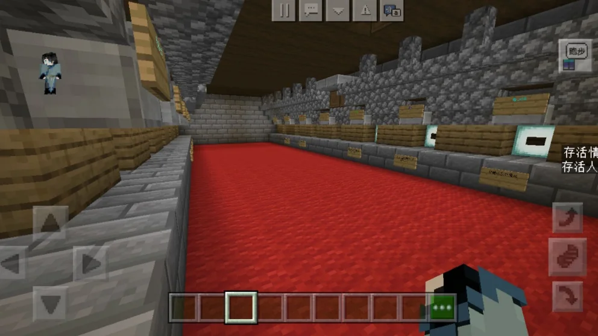

## 作品展示

## 商店说明

游戏简介：

作者：水晶215，建造老e

关于游戏：

［ES］系列是由建造老e以及水晶215联合创造的竞技类小游戏会有衍生材质包，若没有则表示正在审核

本游戏目标为击败所有在场玩家，成为最后一民战士。

职业共计12个，职业不可重复，§4规定时间内未选择职业者会依旧参赛！！！

本游戏拥有观战系统，草丛隐身等特色。

期待您的下载！

制作不易，烦请5星！

---

以上为原商店说明，旧联系方式及招募文字仅作历史记录。当前联系入口见[关于我们](#/studio)。

[查看网易资源中心原页面](https://resource-minecraft.h5.163.com/#/detail?uid=2772171834&id=4649725567306540590) · 收录日期：2026-10-10
