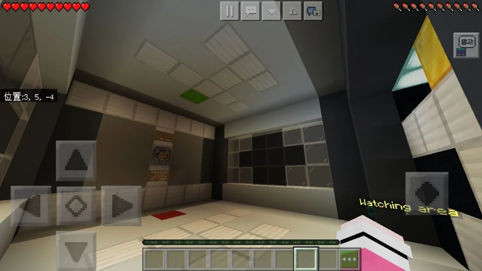
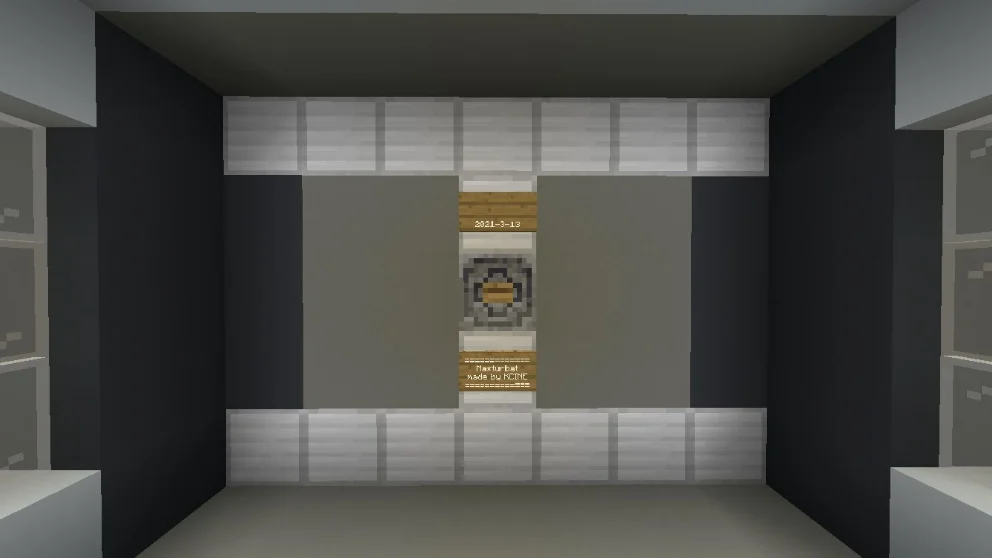
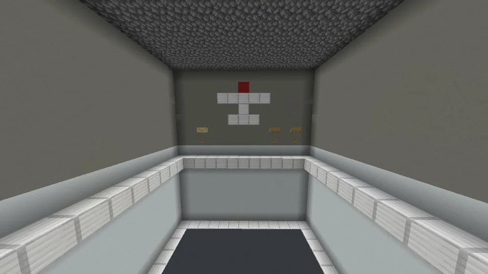

## 作品展示

## 商店说明

**作者:KCINE**

\<Hit the plane\>

打灰机小游戏

双人对战更多乐趣

设置有观战台，嘲讽功能，管理区

=========================================

**游戏玩法**

**双人对战**

**两名玩家各自摆放4架自己的飞机（雪球放置飞机，钓鱼竿选择方向）**

**摆放完毕后，游戏正式开始**

**此时玩家手里只有钓鱼竿，并且轮到本回合的玩家脚下出现闪烁的金块**

**金块所在的坐标便是你要轰炸对方的坐标**

**使用钓鱼竿进行轰炸**

**若返回一个黑色的方块，则代表此坐标为空气（没有飞机的格子）**

**若返回一个白色方块，则代表此坐标为机身部位**

**若返回一个红色或者黄色的格子，则代表此坐标为机头，也就是说，你打爆了敌人的一架飞机**

**打爆四架对方的飞机即可获胜**

**========================================**

*注意事项！！！*

*管理区控制重置游戏，创造才可以进入！*

*所有按钮都要靠近按才有用！！！*

了解更多关于我们抑或想加入我们，请加入群聊（qq）：***1060796710***

***若有bug及改进之处，请联系作者哦***

如果喜欢我们的作品，别忘了给一个好评哦

Fimel Studio交流群937760015/1060796710

Fimel Studio也在火热招贤纳士啦，我们热烈欢迎有经验有技术的指令人员，建筑人员，addons制作者，视频剪辑以及宣传人才加入我们，加群就可以审核啦

---

以上为原商店说明，旧联系方式及招募文字仅作历史记录。当前联系入口见[关于我们](#/studio)。

[查看网易资源中心原页面](https://resource-minecraft.h5.163.com/#/detail?uid=2772171834&id=4646050867772266368) · 收录日期：2026-10-10
