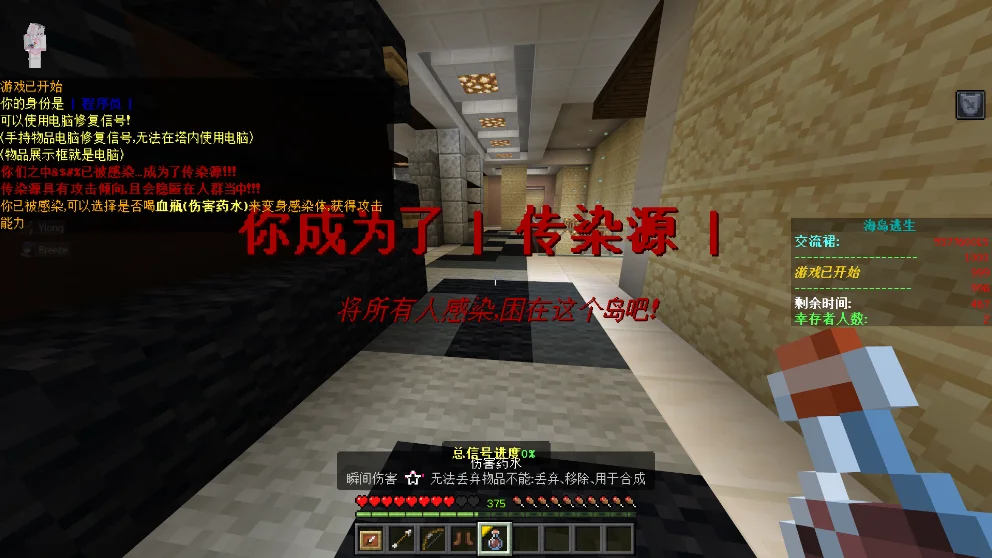
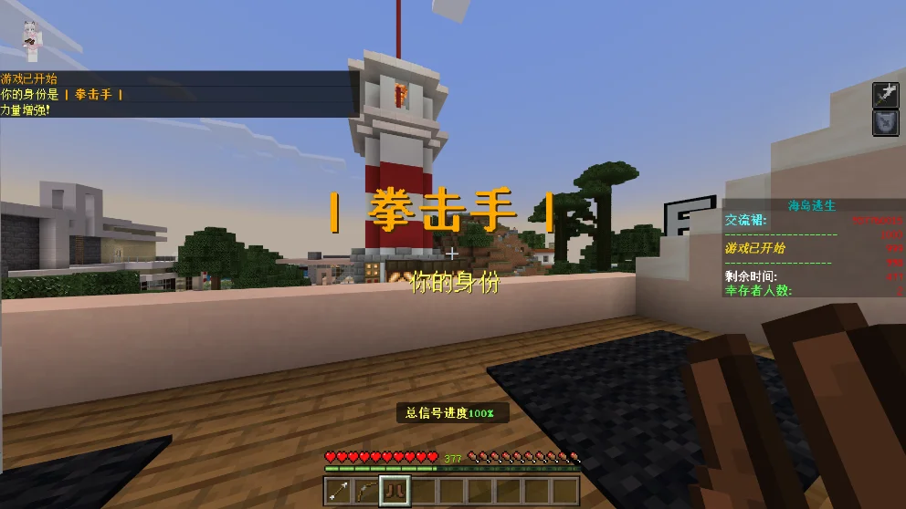

# 《海岛逃生--黎明前夕》

## 作品展示

建议游戏人数：4-8人

## 地图信息

作者：初风sky_、歪浪YL、\_橙子不成\_、水晶215

海岛建筑：白鲨先森(已授权)

特别鸣谢：协助建造的Fimel工作室成员、缘Texas、以及参与测试的所有人员

Fimel工作室交流群q：9377060015

## 剧情

你和好友们乘船来到这座岛上游玩，没想到这座岛上有生化病毒，可是此时游轮燃油耗尽，无法乘船离开，身为不同职业的你们需要互相帮助，修复信号塔，逃离这里!

这座岛上好像还藏着一些不为人知的秘密...

## 游戏玩法

游戏分为两个阵营：人类阵营、感染者阵营，

人类需要修复岛上的信号塔进度完成之后即可呼叫直升机撤离；

感染者则是要阻止人类修复信号塔，并把他们尽数感染。

岛上的信号塔一共有五座，分别为东塔、东南塔、北塔、西北塔、核心塔，其中核心塔修复后加50%信号进度，其余四座塔分别增加25%信号进度，信号进度达100%时自动呼叫直升机，直升机将在100秒后到达。
