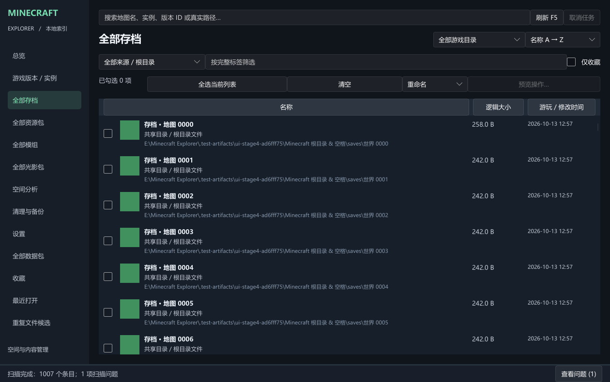
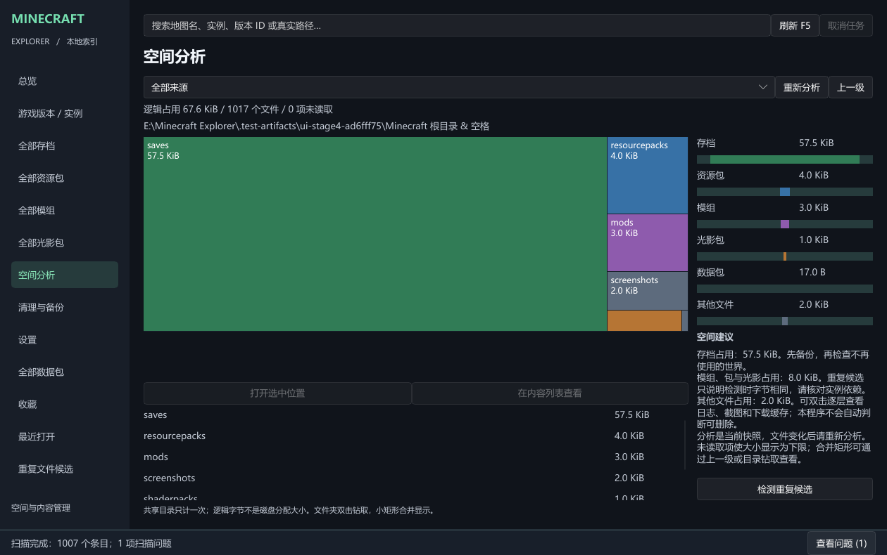
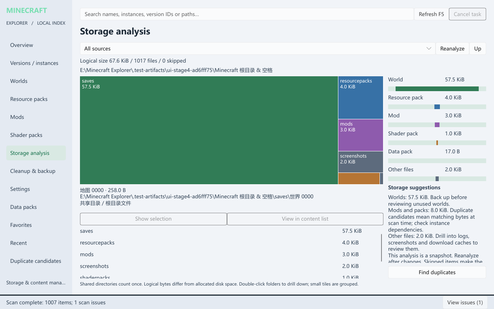

# Minecraft Explorer

A native local manager for Minecraft Java worlds, resource packs, mods, shader packs and data packs across launchers and modpacks. Find content, check its game directory, analyze storage, and back up or manage files after reviewing each operation.

## Download and run

Use the Download button above to get **MinecraftExplorer-1.0-win-x64.exe**, then run it directly. No installer or extraction is needed. Keep it in any readable folder; it does not have to be inside Minecraft. Close an older running version before updating.

Designed for Windows 10/11 x64. The tool needs no Rust, Java or external icon files. Microsoft Visual C++ x64 runtime is required; if `VCRUNTIME140.dll` is missing, install the [official Microsoft runtime](https://learn.microsoft.com/en-us/cpp/windows/latest-supported-vc-redist). Clean Windows virtual machines have not been tested. An HMCL JAR installation needs its own Java runtime.

## First use

1. In **Settings**, add the Minecraft root containing `versions`, such as `D:\PCL2\MinecraftPcl`. Do not select only the `versions` subfolder. Custom game directories can be added separately with an associated root.
2. The app selects the new directory in **Space analysis**, refreshes the index, then automatically analyzes it. Cancel preserves the association and completed results and skips remaining automatic analysis.
3. Search worlds, packs or mods by name, instance or path. Filter by game directory and sort by size or time. Select an item for details; double-click or press Enter to locate it in Windows Explorer.
4. Organize favorites and tags. **F5** refreshes the index. Directory watching is enabled by default and can be disabled in Settings.
5. Choose **Chinese / English** and **Dark / Light** in Settings. Changes apply immediately and persist.

## Storage and backups

The treemap represents logical file sizes. Double-click folders to drill down and use Up to return. Overlapping sources are counted once; skipped content produces an explicit lower bound. Logical bytes differ from allocated disk space. Reanalyze after files change to update the snapshot.

Select content to rename, copy, move, back up or recycle. Generate a preview, check the paths, and explicitly confirm. Copy and move verify content; existing files are not overwritten and recycling has no permanent-delete fallback. Backups must be outside registered game directories and are verified before restoring. Close Minecraft first; this tool does not provide hot backups of running worlds.

If scanning or monitoring encounters a problem, use View issues in the status bar to see the affected paths and causes. Duplicate messages are combined; the latest 100 from this session are kept. Clear removes messages without changing files. File-operation errors remain in their dialog and recovery records remain in Cleanup & backup.

## Launchers

Register **PCL2, PCL CE or HMCL** in Settings and map an item's target version. Open selected launcher opens the original launcher; select and start the game there.

To run a particular version from this app, link its launcher-exported **BAT / CMD** and working directory, then use Run linked launch script. Direct launching requires this version’s script; after opening a launcher, select the version there. Scripts can contain login information; keep them private.

PCL2 / PCL CE can automatically detect an existing script. Launch the target version once in the original launcher, then open Set mapping. Both the script version and game directory must match exactly before the app fills the fields. A separate copy under the app data launch-scripts directory protects the mapping from later launches. Review and save the mapping; Auto-detect retries. Unmatched or unsupported formats still need a manual script. Copies may contain original login parameters; keep them private. Launch the version again in the original launcher and detect again after login expires.

## Data and licenses

Settings, index, favorites and tags default to `%LOCALAPPDATA%\MinecraftExplorer\`. Scanning and storage analysis do not modify game files or upload content. File operations require a preview and confirmation. Removing a source only removes the app's association.

Original source is MIT licensed. Third-party license texts and Slint attribution are embedded in the EXE. **Settings → About → Export third-party licenses** exports the texts to the app data directory for offline reading.

[Source code](https://github.com/Ylong4004/Minecraft-Explorer) · [Full guide](https://github.com/Ylong4004/Minecraft-Explorer/blob/main/docs/README.en.md) · [Report an issue](https://github.com/Ylong4004/Minecraft-Explorer/issues)

## Interface gallery

Actual application screenshots with generated demonstration worlds and files. Displayed sizes are not real modpack measurements.

