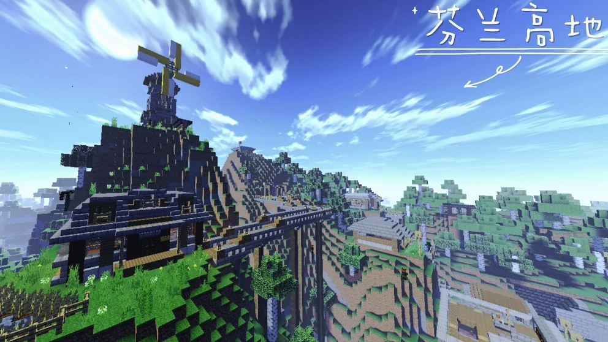
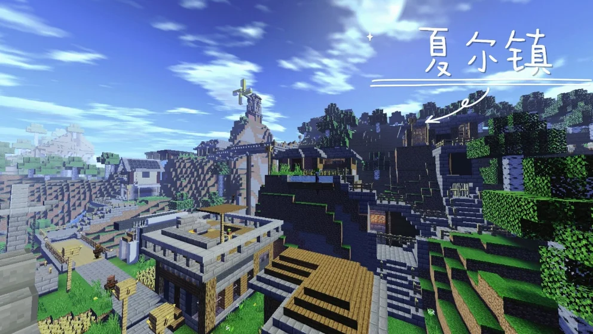
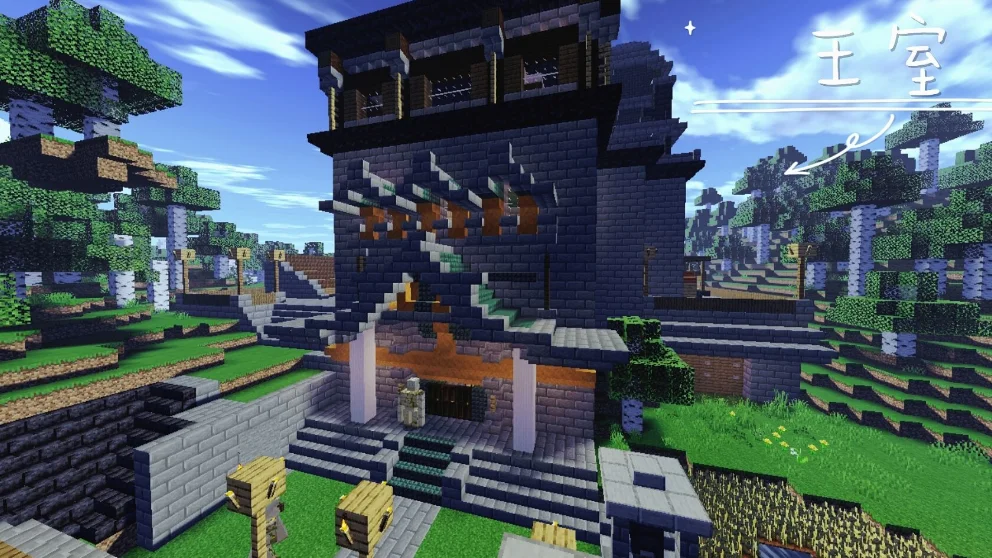

## 作品展示

## 商店说明

冒险家，欢迎来到夏尔镇。这里有风光旖旎的芬兰高地，有戒备森严的王室，热闹的集市。

--作者的话

故事背景：拥有两百年历史的夏尔镇，在过去的几年间饱受掠夺者的侵略，现在，你来到了这里虽然你一穷二白，但王室把领主职位赋予你。你可以作一位爱好和平的君主，也可带领村民一举攻下掠夺者的老巢。贤明的君主，你会作何选择？

本地图由：建筑老e以及水晶215制作完成。

=========================

如果喜欢我们的作品，别忘了给一个好评哦

Fimel Studio交流群807646558/1060796710

Fimel Studio也在火热招贤纳士啦，我们热烈欢迎有经验有技术的指令人员，建筑人员，addons制作者，视频剪辑以及宣传人才加入我们，加群就可以审核啦

---

以上为原商店说明，旧联系方式及招募文字仅作历史记录。当前联系入口见[关于我们](#/studio)。

[查看网易资源中心原页面](https://resource-minecraft.h5.163.com/#/detail?uid=2772171834&id=4648775938384483560) · 收录日期：2026-10-10
