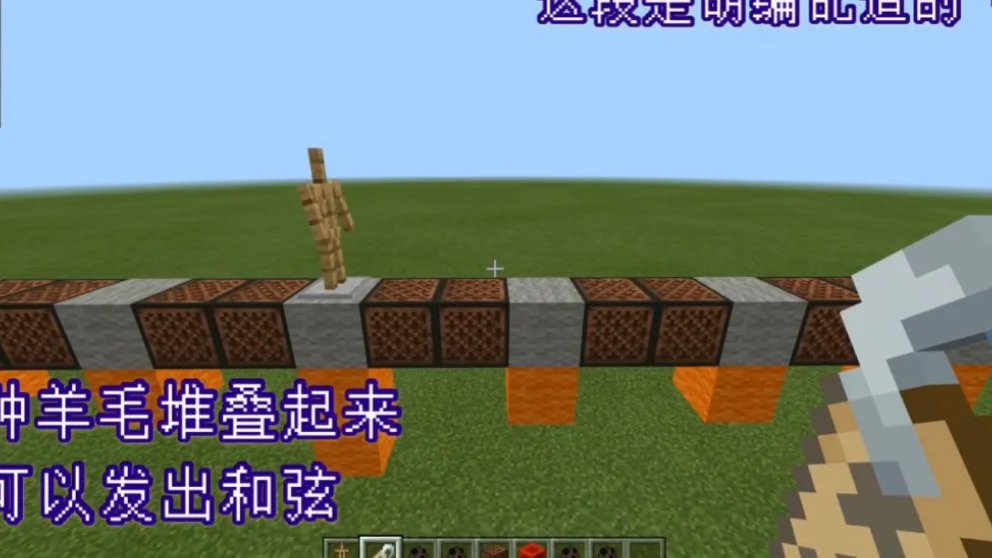
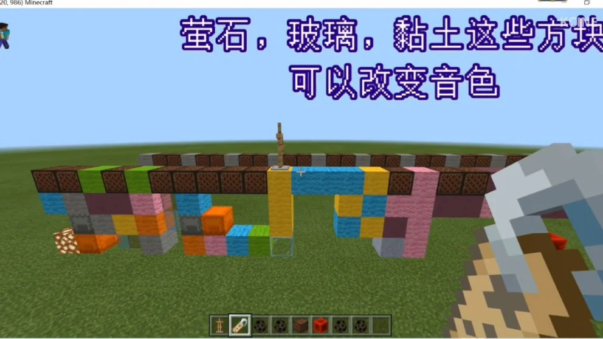
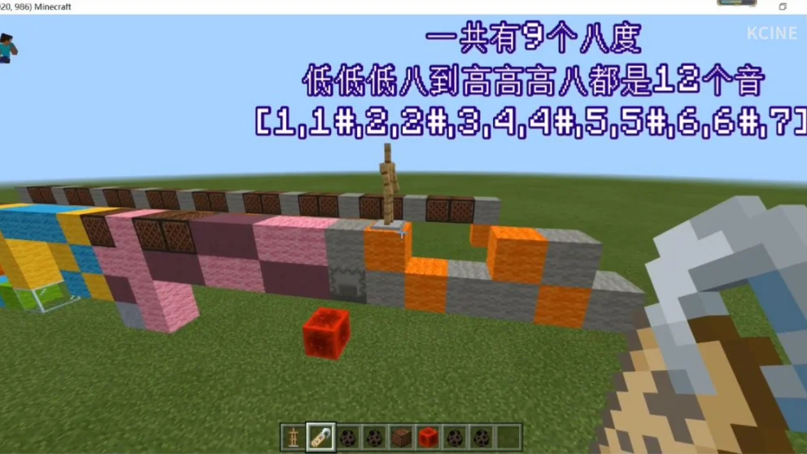

## 作品展示

## 商店说明

\<Cinemusicedit\>音乐制作命令包

版本[0.0.4]-更新日期21-6-6

Cinemusicedit使用说明**:[指令进阶玩法]，[指令师用]**

**如果装载组件后打不开，请耐心等待一段时间（组件较大）**

**(0)本命令包供指令师音乐师使用，不会用勿喷)本命令包供指令师音乐师使用，不会用勿喷)本命令包供指令师音乐师使用，不会用勿喷**

(1)本音乐制作函数包内含9个八度(高高高高八度部分音阶[1,1#,2];以及高高高八度十二音阶[1,1#,2,2#,3,4,4#,5,5#,6,6#,7],~~~,低低低八度十二音阶,低低低低八度部分音阶[1]

(2)给蝙蝠生成蛋命名再放置于地即可进行音乐创作.命名准则:dddd1为低低低低八度1调，gg2为高高八度2调,5#为中央5#调，其他音阶以此类推

(3)本音乐制作函数包共含mc原声大碟16种音色note.给蝙蝠取名如harp,pling等即可进行音色转换

**(4)用于播放音乐的盔甲架给予命名cineplayer,盔甲架的朝向决定了您的音乐的播放顺序,lll注意lll!只有当此盔甲架经过转换音色的方块后才能正常播放音乐,同时,您也需要给自己一个listen的tag，没有listen这个tag的玩家是听不到音乐的!!!**

(5)cineplayer在移动的过程中,会识别其下方一至四格的所有方块,也就是说,cineplayer完全可以做到和弦,不仅如此,cineplayer还支持多声道/多线程播放

(6)关于一些您须知的事:1.Cinemusicedit采用方块类型转playsound音符输出的结构2.**您需要搭建的命令方块架构如下:**

**rcb(指令格式):function cinemusicmaker(重复命令方块)**

**rcb(指令格式):function cinemusicplayer(重复命令方块)**

**执行命令后如果有文本提示，那么一切就大功告成了**

第一个命令方块建议调零延迟,第二个命令方块的延迟决定了乐曲的节拍,可以根据您的需要来操作

如果喜欢我们的作品，别忘了给一个好评哦

Fimel Studio交流群807646558/1060796710

Fimel Studio也在火热招贤纳士啦，我们热烈欢迎有经验有技术的指令人员，建筑人员，addons制作者，视频剪辑以及宣传人才加入我们，加群就可以审核啦

---

以上为原商店说明，旧联系方式及招募文字仅作历史记录。当前联系入口见[关于我们](#/studio)。

[查看网易资源中心原页面](https://resource-minecraft.h5.163.com/#/detail?uid=2772171834&id=4646512948266854981) · 收录日期：2026-10-10
